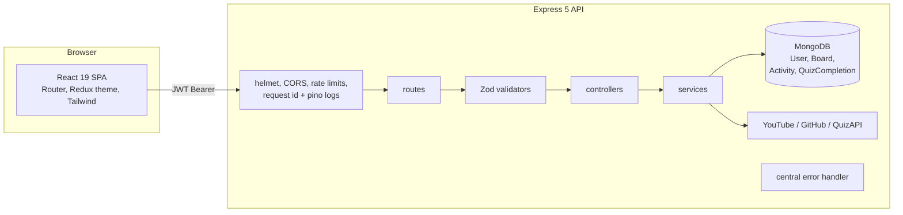

# PinLearn

A Pinterest-style learning tracker. Pick interests, discover YouTube videos and GitHub repositories, save them to boards, track progress with notes, plan work on a Kanban board, and build a daily streak by completing quizzes and finishing resources.

## Screenshots

> Add screenshots to `docs/screenshots/` and link them here.

| Dashboard | Boards | Kanban |
|---|---|---|
| `docs/screenshots/dashboard.png` | `docs/screenshots/boards.png` | `docs/screenshots/kanban.png` |

## Architecture



### Backend layout (`backend/`)

| Folder | Responsibility |
|---|---|
| `config/` | Zod-validated env, DB connection, CORS policy |
| `routes/` | URL to middleware to controller wiring; one auth gate for all private routes |
| `validators/` | Zod schemas for every body, query and param |
| `controllers/` | HTTP concerns only: read validated input, call services, shape the response |
| `services/` | Business logic and integrations: tokens, streaks, quiz scoring, YouTube/GitHub clients |
| `middleware/` | Auth, validation, rate limiters, central error handler |
| `models/` | Mongoose schemas with field limits and indexes |
| `utils/` | Logger, `AppError`, URL sanitiser |

### Frontend layout (`Pinterest/src/`)

`api/` (fetch wrapper + per-feature clients), `routes/` (`RequireAuth`, `AppLayout`, page adapters), `components/`, `hooks/`, `store/`.

### Request flow

1. The SPA calls `apiRequest()`, which attaches the JWT from `sessionStorage`.
2. Express assigns a request id, applies helmet, CORS and the rate limiter.
3. `authMiddleware` verifies the token and sets `req.userId`.
4. `validate()` parses the request with Zod; bad input returns `400` before any logic runs.
5. The controller calls services and models; every query is scoped by `userId`.
6. Any thrown error reaches one handler that returns `{ message, code, details?, requestId }`.
7. A `401` on an authenticated call clears the session client-side and redirects to login.

## Setup

Requirements: Node 20+, MongoDB (local or Atlas).

```bash
# API
cd backend
cp .env.example .env      # fill in MONGODB_URI and JWT_SECRET at minimum
npm install
npm run dev               # http://localhost:5000

# Web (new terminal)
cd Pinterest
npm install
npm start                 # http://localhost:3000
```

Or run everything with Docker: `JWT_SECRET=<long random value> docker compose up --build`.

### Scripts

| Where | Command | What |
|---|---|---|
| `backend` | `npm test` | Unit and HTTP integration tests (Node test runner + supertest) |
| `Pinterest` | `npm test` | Jest + Testing Library |
| `Pinterest` | `npm run build` | Production build (warnings fail in CI) |

CI (`.github/workflows/ci.yml`) runs both test suites, the frontend build, `npm audit` and both Docker builds.

## API summary

All routes are under `/api`. Everything except `health`, `ready`, `signup` and `login` requires `Authorization: Bearer <jwt>`.

| Method | Path | Notes |
|---|---|---|
| GET | `/health`, `/ready` | Liveness; readiness reports `503` when MongoDB is down |
| POST | `/signup`, `/login` | Strict rate limit (20 per 15 min) |
| GET, PATCH | `/profile`, PATCH `/interests` | |
| GET, PATCH | `/kanban` | |
| GET, POST, DELETE | `/boards`, `/boards/:id` | Unique name per user, case-insensitive |
| POST | `/boards/:id/resources` | Only `http(s)` URLs accepted |
| PATCH | `/progress/status` | |
| POST, PATCH, DELETE | `/resources/note` | |
| GET | `/youtube`, `/github` | Auth plus 30 requests per minute per user |
| GET, POST | `/quizzes`, `/quizzes/:id/questions`, `/quizzes/:id/complete` | Scored server-side |
| GET | `/streak` | |

## Design decisions

- **Layered backend.** Controllers stay thin; streak and scoring logic are pure functions that are unit-tested without a database.
- **Zod at the boundary.** One validation layer for every input. Schemas coerce types, so object payloads such as `{ "$ne": null }` cannot reach a query.
- **Server-derived streaks.** The old public `POST /api/activity` let a client claim a streak day. Activity is now recorded only after verified actions: a scored quiz, saving a new resource, or completing a resource for the first time. Known limit: an authenticated user can still save arbitrary resources, so a stricter model would require provider-verified resources.
- **Streak storage.** Days are `YYYY-MM-DD` strings in a configurable timezone (`APP_TIMEZONE`), with one unique row per user per day, which makes the daily write idempotent.
- **Board uniqueness without races.** A case-folded `nameKey` with a partial unique index guarantees uniqueness; the controller maps the duplicate-key error to `409`.
- **Bounded cache.** The YouTube cache has a TTL, a size cap and request coalescing so concurrent identical searches cost one quota hit.
- **Session in `sessionStorage`.** Tokens are not shared across tabs or persisted past the session.

## Security considerations

- Passwords hashed with bcrypt (cost 12), limited to 72 characters; login runs a dummy comparison for unknown emails to flatten timing.
- JWTs pinned to `HS256`, 7 day expiry (`JWT_EXPIRES_IN`). There is no refresh or revocation yet; the next step is short-lived access tokens plus an httpOnly refresh cookie.
- `helmet`, a 100 KB body limit, global and per-route rate limits, and per-user limits on paid third-party proxies.
- CORS fails closed in production when `CORS_ORIGINS` is empty.
- Resource URLs are restricted to `http(s)`, so `javascript:` links cannot be stored.
- Passwords are `select: false`; logs redact `Authorization` headers; provider error bodies are never returned to clients.
- Provider API keys are sent in headers, not URLs. The self-signed TLS escape hatch is ignored in production.
- All board queries filter by `userId`, so one user cannot read or modify another's data.

## Known limitations

- Tokens in `sessionStorage` are readable by any XSS; no refresh or revocation.
- Boards embed resources and notes (capped at 500 and 100) rather than using separate collections.
- Rate limiting and the YouTube cache are in-memory, so they are per instance; use Redis when scaling out.
- Integration tests cover routing, auth, validation and error shape; DB-backed flows are not yet covered (a MongoDB-memory-server suite is the next step).
